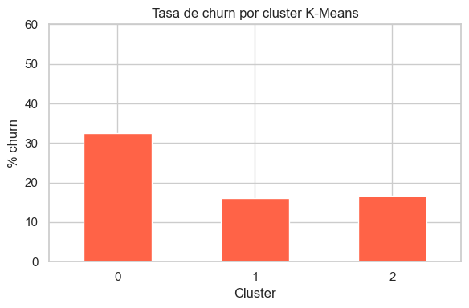
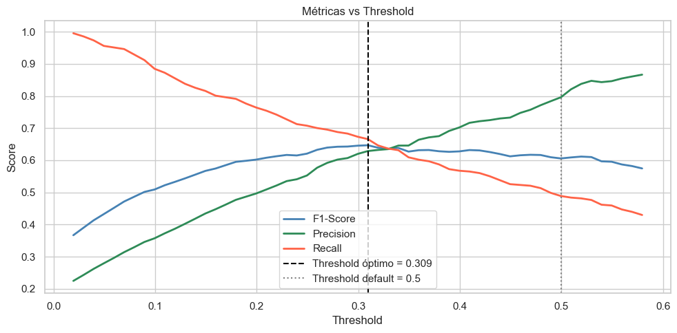

# Informe ejecutivo — Hallazgos del análisis de abandono de clientes

FinanceGuard · Predicción de churn en banca digital · Mauricio Melgarejo

Este informe resume, en lenguaje de negocio, los hallazgos del análisis de abandono (churn) de clientes y qué decisiones de retención habilitan. El detalle técnico está en los 4 notebooks de este repositorio.

---

## 1. Resumen ejecutivo

Sobre una base de 10.000 clientes con una tasa de abandono del 20%, el modelo final identifica con buena precisión quién está en riesgo, y el análisis revela un segmento de riesgo muy concentrado.

- **El modelo final detecta 2 de cada 3 clientes que efectivamente van a abandonar** (recall 66,6%), frente a 1 de cada 5 del modelo base (recall 19%) — una mejora que permite intervenir a tiempo en muchos más casos que antes de optimizar.
- **Los clientes en Alemania tienen 2,27 veces más probabilidad de abandonar** que el resto — es la señal geográfica más fuerte del dataset.
- **El segmento de mayor riesgo combina balance alto e inactividad**: hasta 78% de abandono en ese grupo específico, identificado mediante clustering, no mediante una regla simple de negocio.
- **Ajustar el umbral de decisión del modelo (threshold) permitió identificar 72 clientes en riesgo adicionales** que el modelo hubiera pasado por alto con la configuración por defecto — sin entrenar un modelo nuevo, solo cambiando dónde se traza la línea de decisión.

**Impacto esperado:** el hallazgo de Alemania y el segmento balance-alto-e-inactivo dan dos criterios concretos y de bajo costo de implementación para priorizar a quién contactar primero en una campaña de retención.

---

## 2. Recomendaciones de negocio

1. **Priorizar campañas de retención en clientes alemanes**, dado que el riesgo relativo (2,27x) es el más alto de todas las variables geográficas analizadas.
2. **Diseñar una intervención específica para clientes con balance alto e inactivos** — es el segmento de mayor riesgo identificado (hasta 78% de churn) y probablemente el de mayor valor a retener, dado su balance.
3. **Adoptar el threshold optimizado (0,309) en lugar del default (0,5)** en cualquier implementación productiva del modelo — el análisis muestra que agrega 72 clientes en riesgo detectados sin necesidad de volver a entrenar.
4. **Monitorear la inactividad como señal temprana**, no solo como consecuencia: el modelo encuentra que la inactividad por sí sola es un factor protector invertido (0,36x) cuando se mira aislada, pero se vuelve crítica combinada con balance alto — la lectura aislada de esa variable puede inducir a una conclusión equivocada.

---

## 3. Limitaciones y supuestos

- El dataset (`Churn_Modelling.csv`) es una muestra pública estándar para este tipo de ejercicio, no datos de un banco real — los números de negocio (AUC, recall, 2,27x) describen el comportamiento de este dataset específico, no una proyección directa a cualquier banco digital.
- El segmento "balance alto + inactivo → 78%" viene de un análisis de clustering (DBSCAN) sin etiqueta de negocio predefinida — es un patrón descubierto en los datos, y conviene validarlo con el equipo de negocio antes de construir una campaña entera alrededor de él.
- El threshold de 0,309 fue optimizado para maximizar la detección (recall) sobre este dataset de prueba; en producción, ese valor óptimo puede cambiar si el costo real de un falso positivo (contactar a alguien que no se iba a ir) es distinto al asumido en este ejercicio.

---

## 4. Evidencia

Fuente: elaboración propia sobre el dataset de 10.000 clientes — tasa de abandono por país y género.

Fuente: elaboración propia — tasa de abandono por segmento identificado con K-Means.

Fuente: elaboración propia — Precision, Recall y F1 según el umbral de decisión del modelo.

---

## 5. Metodología y fuentes

10.000 clientes · 11 variables tras limpieza · variable objetivo `Exited`. Modelos comparados: Regresión Logística (baseline), Random Forest, XGBoost, LightGBM, CatBoost (ganador, AUC 0,868), con búsqueda de hiperparámetros vía Optuna. Segmentación no supervisada con K-Means, DBSCAN, PCA y t-SNE. Optimización final del umbral de decisión maximizando F1/Recall. Detalle completo en los 4 notebooks de este repositorio.
