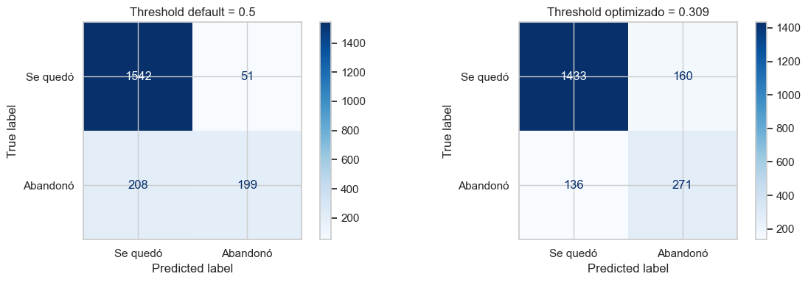

# FinanceGuard — Predicción de Churn en Banca Digital

Proyecto de Machine Learning para predecir abandono de clientes en un banco digital ficticio.
Módulo 4 — Soy Henry Data Science AI.

---

## Problema de negocio

Un banco digital con 10.000 clientes y una tasa de churn del 20% necesita identificar
qué clientes van a abandonar el servicio antes de que ocurra, para tomar acciones de
retención a tiempo.

---

## Dataset

- 10.000 registros · 11 features tras limpieza
- Variable objetivo: `Exited` (1 = abandonó, 0 = se quedó)
- Fuente: Churn_Modelling.csv

---

## Notebooks

| # | Notebook | Contenido |
|---|---|---|
| 1 | EDA + Regresión Logística | Análisis exploratorio, baseline AUC 0.775 |
| 2 | Gradient Boosting y Optimización | Random Forest, XGBoost, LightGBM, CatBoost, Optuna |
| 3 | Aprendizaje No Supervisado | K-Means, DBSCAN, PCA, t-SNE |
| 4 | Optimización de Threshold | Threshold 0.309, Recall 0.666 |

---

## Resultados

| Métrica | Baseline (Regresión Logística) | Modelo final (CatBoost) | Mejora |
|---|---|---|---|
| AUC | 0.775 | **0.868** | +0.093 |
| Recall | 0.19 | **0.666** | +0.476 |
| Precision | — | 0.80 | — |

El baseline detectaba menos de 1 de cada 5 clientes que efectivamente abandonaban (recall 0,19). El modelo final detecta 2 de cada 3 (recall 0,666) — la mejora central del proyecto no está en el AUC, sino en esa capacidad de detección real.

**Dos comparaciones distintas, para no confundirlas:** la tabla de arriba compara dos *modelos* (Regresión Logística baseline vs. CatBoost final), ambos en su threshold por defecto (0,5). La matriz de abajo compara, dentro del *mismo* modelo final (CatBoost), dos *thresholds* distintos: 0,5 vs. 0,309. Por eso el recall de CatBoost a threshold 0,5 (199/407 = 0,489, visible en la matriz) no es ni el 0,19 de la tabla (ese es otro modelo) ni el 0,666 del threshold optimizado (ese es otro threshold) — son tres números de tres combinaciones distintas de modelo×threshold, no un error de cálculo.

Matriz de confusión del modelo final (CatBoost) con threshold 0,5 vs. 0,309, sobre el mismo conjunto de prueba (2.000 clientes, 407 abandonos reales). La diferencia entre ambos thresholds es exactamente los 72 clientes adicionales detectados: 271 vs. 199 verdaderos positivos.

**Por qué se priorizó recall sobre precision:** en un problema de retención, el costo de no detectar a un cliente que se va (falso negativo) es perder ese cliente; el costo de contactar a alguien que en realidad no se iba (falso positivo) es, como máximo, una acción de retención de más. Esa asimetría justifica optimizar el threshold para maximizar recall en vez de dejarlo en el valor por defecto — con threshold optimizado (0,309) se detectan **72 clientes en riesgo adicionales** frente a la configuración default (0,5).

**Hallazgos clave:**
- Clientes en Alemania tienen 2.27x más probabilidad de churn
- Clientes inactivos tienen 0.36x probabilidad (factor protector invertido)
- Segmento de mayor riesgo: balance alto + inactivo → churn hasta 78% (DBSCAN)

**Prevención de fuga de datos:** se eliminaron `RowNumber`, `CustomerId` y `Surname` antes de entrenar — son identificadores sin poder predictivo real que podrían filtrar información indirecta (ej. orden de carga de los datos) sin aportar señal genuina de negocio.

---

## Stack

Python · Pandas · scikit-learn · XGBoost · LightGBM · CatBoost · Optuna · Matplotlib · Seaborn

---

## Autor

Mauricio Melgarejo · [LinkedIn](https://www.linkedin.com/in/mauricio-daniel-melgarejo-amaro-482596105/) · [GitHub](https://github.com/mmelgarejo-ds)
