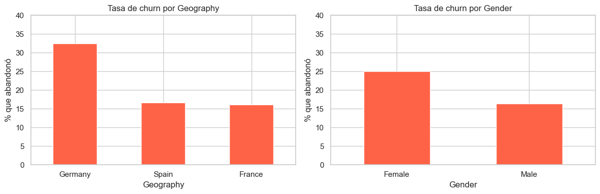

# FinanceGuard — Predicción de Churn en Banca Digital


Proyecto de Machine Learning para predecir abandono de clientes en un banco digital ficticio.
Módulo 4 — Soy Henry Data Science AI.

---

## Problema de negocio

Un banco digital con 10.000 clientes y una tasa de churn del 20% necesita identificar
qué clientes van a abandonar el servicio antes de que ocurra, para tomar acciones de
retención a tiempo.

---

## Dataset

- 10.000 registros · 11 features tras limpieza
- Variable objetivo: `Exited` (1 = abandonó, 0 = se quedó)
- Fuente: Churn_Modelling.csv

---

## Notebooks

| # | Notebook | Contenido |
|---|---|---|
| 1 | EDA + Regresión Logística | Análisis exploratorio, baseline AUC 0.775 |
| 2 | Gradient Boosting y Optimización | Random Forest, XGBoost, LightGBM, CatBoost, Optuna |
| 3 | Aprendizaje No Supervisado | K-Means, DBSCAN, PCA, t-SNE |
| 4 | Optimización de Threshold | Threshold 0.309, Recall 0.666 |

---

## Resultados

| Métrica | Baseline (Regresión Logística) | Modelo final (CatBoost) |
|---|---|---|
| AUC | 0.775 | **0.868** |
| Recall | 0.19 | **0.666** |
| Precision | — | 0.80 |

Con threshold optimizado: **72 clientes en riesgo adicionales detectados** vs configuración por defecto.

**Hallazgos clave:**
- Clientes en Alemania tienen 2.27x más probabilidad de churn
- Clientes inactivos tienen 0.36x probabilidad (factor protector invertido)
- Segmento de mayor riesgo: balance alto + inactivo → churn hasta 78% (DBSCAN)

**Qué significan estos números para el negocio:** si un banco dirigiera una campaña de retención guiada por este modelo, debería contactar primero a clientes alemanes con balance alto e inactividad reciente — son el segmento con mayor probabilidad de abandono detectada en este dataset. Esto es una hipótesis derivada del análisis, no un resultado medido en una campaña real: no hay datos de costo de retención ni de tasa de éxito de contacto para proyectar un retorno económico.

**Prevención de leakage:** se descartaron antes de modelar las columnas puramente identificadoras (`RowNumber`, `CustomerId`, `Surname`), que no aportan señal predictiva y podrían introducir sobreajuste específico del dataset. El resto de las variables (balance, actividad, geografía, edad) están disponibles en el momento de hacer la predicción, sin usar información posterior al resultado.

<p align="center"></p>
<p align="center"><sub>Tasa de abandono por país y género. Más detalle y gráficos adicionales en <a href="INFORME_EJECUTIVO.md">INFORME_EJECUTIVO.md</a>.</sub></p>

---

**Informe ejecutivo** (hallazgos y recomendaciones de negocio, pensado para lectores no técnicos): [`INFORME_EJECUTIVO.md`](INFORME_EJECUTIVO.md).

---

## Stack

Python · Pandas · scikit-learn · XGBoost · LightGBM · CatBoost · Optuna · Matplotlib · Seaborn

---

## Cómo reproducirlo

```bash
git clone https://github.com/mmelgarejo-ds/FinanceGuard.git
cd FinanceGuard
pip install -r requirements.txt
jupyter notebook
```

Correr los notebooks en orden (1 → 2 → 3 → 4). El dataset `Churn_Modelling.csv` es un dataset público estándar de Kaggle, no incluido en el repo por licencia de distribución.

---

## Autor

Mauricio Melgarejo · [LinkedIn](https://www.linkedin.com/in/mauricio-daniel-melgarejo-amaro-482596105/) · [GitHub](https://github.com/mmelgarejo-ds)
